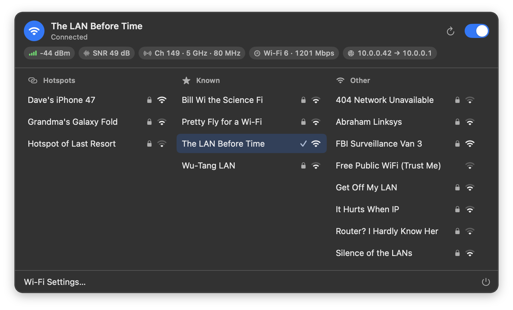

<div align="center">


# Wi-Fi Picker

**A macOS Wi-Fi menu that opens instantly and never moves the row under your mouse.**

[](https://github.com/STRML/wifi-picker/releases/latest)
&nbsp;




</div>

## Why

You open the stock Wi-Fi menu, aim at a network, and the list re-sorts under the cursor as signal
readings trickle in. You click the wrong one. Every time.

```
 stock menu                              Wi-Fi Picker
 ──────────                              ────────────
 click ─▶ scan starts (up to 13 s)       click ─▶ list macOS already has, ~66 ms
       ─▶ rows appear one by one               ─▶ order frozen while open
       ─▶ rows re-sort as RSSI changes         ─▶ signal bars update in place
       ─▶ you click the wrong network          ─▶ new networks append at the bottom
```

Measured on an M5 Max: a cold `scanForNetworks` took **12.96 s**, reading the system scan cache
took **66.6 ms**, and that cache already held 16 of the 17 networks a fresh scan found.

## What you get

| | |
|---|---|
| **Three columns** | Hotspots, Known and Other, side by side instead of stacked. Alphabetical within each column, so the same networks always land in the same place. |
| **Nothing moves** | The layout freezes when the panel opens. Signal bars and the checkmark update inside their cells; a network that shows up late goes to the bottom of its own column. |
| **Connection stats** | RSSI, SNR, channel, band, width, Wi-Fi generation, link rate, your IP and router, live while the panel is open. The stock menu hides most of this behind Option-click. |
| **Click to join** | Saved networks try the password macOS already has. If macOS won't share it, or the network is new, a password sheet floats over the grid instead of pushing it around. |
| **Keyboard** | Arrows move across the grid, Return joins, `⌘R` rescans, Esc closes. |
| **Lightweight** | No timers and no background scanning while closed. See [below](#how-light-is-it). |

## Install

1. Download `WifiPicker-<version>.zip` from [Releases](https://github.com/STRML/wifi-picker/releases/latest) and drag **Wi-Fi Picker** into `/Applications`.
2. Open it. Allow Location access when asked (see [why](#why-does-it-want-location-access)).
3. Hide Apple's Wi-Fi icon: **System Settings → Control Center → Wi-Fi → Don't Show in Menu Bar**.
4. Optional: add it to **System Settings → General → Login Items**.


## How light is it?

| State | What runs | Cost |
|---|---|---|
| Closed | Nothing on a timer. Menu bar icon updates on power, network and link-change events. | 0.00 s CPU over 2 min (below `ps`'s 10 ms resolution), 0 wakeups, 21 MB |
| Opening | One read of the system scan cache. A scan only if macOS hasn't scanned in the last 2 minutes. | ~66 ms |
| Open | Link-quality events for the stats row, a 5 s clock that dims networks gone for 60 s. | stops on close |

## FAQ

### Why does it want Location access?

macOS returns every network name as `nil` to apps without Location permission (since macOS 14).
Wi-Fi Picker never reads your location; it just can't see network names otherwise.

### Where's Instant Hotspot?

Apple's menu can wake your iPhone's hotspot over Bluetooth even when it's off. That's private API
(Apple DTS: ["Personal Hotspot has no API at all"](https://developer.apple.com/forums/thread/852783)).
The Hotspots column shows phone hotspots that are already broadcasting, picked out by name
(iPhone, Galaxy, Pixel, `<name>'s Phone` and friends). Turn the hotspot on from your phone and it shows up.

### Does it scan constantly?

No. macOS already scans roughly once a minute on its own. Wi-Fi Picker reads those results when
you open it, and only starts its own scan if the cache is more than 2 minutes old or you press
Rescan. Scans hop channels and stall your connection briefly, so it avoids them.

## Build from source

```bash
swift test                     # core layout tests, including a 500-run property test
scripts/install.sh             # build, sign with your Apple Development identity, install to ~/Applications
scripts/release.sh 1.0.0       # universal build, Developer ID signing, notarization via `asc`, stapled zip
WifiPicker.app/Contents/MacOS/WifiPicker --demo --open-panel   # fake networks, for screenshots
```

Requires Xcode 16+ (Swift 6 toolchain). Signing identities are set in `scripts/bundle.sh` and
`scripts/release.sh` (`SIGN_IDENTITY` overrides).

How the freeze works and why each decision went the way it did:
[`docs/superpowers/specs/2026-11-20-wifi-picker-design.md`](docs/superpowers/specs/2026-11-20-wifi-picker-design.md).

## License

MIT
